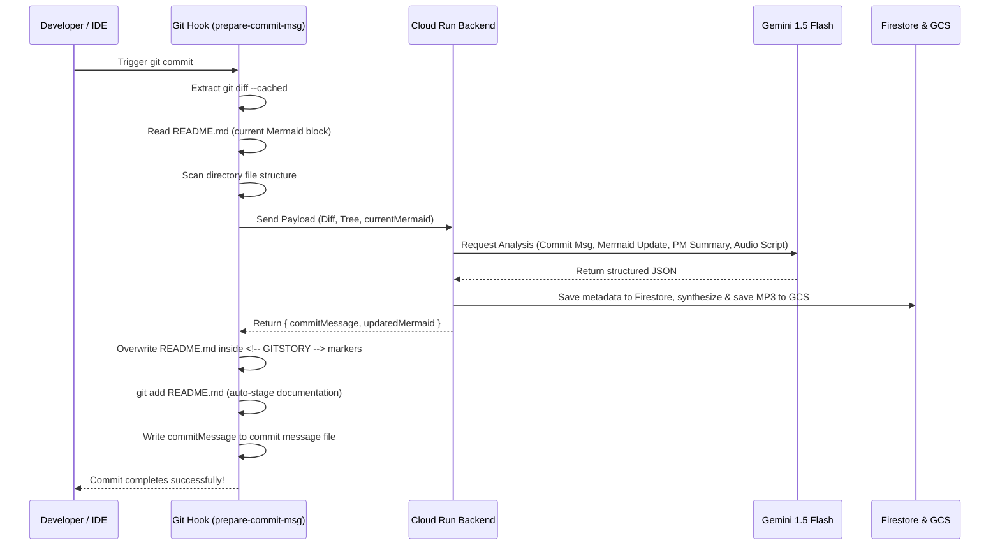

# GitStory AI (The Interactive Project Biographer) - Design Specification

* **Author:** Vity (AI Mentor)
* **Date:** 2026-08-03
* **Target Event:** AI Riser Vietnam 2026 (#BuildwithGoogleAI)
* **Status:** Draft (Pending User Review)

---

## 1. Executive Summary & Unique Selling Point (USP)

### Problem
Documentation in software projects is notoriously outdated. System architecture diagrams (like Mermaid) are rarely updated after the initial draft. Non-technical stakeholders (PMs, clients, QAs) struggle to understand technical code diffs, leading to communication gaps.

### Solution
**GitStory AI** is a "Living Project Biographer" that integrates directly with the developer's Git workflow (via a local git hook). It automatically:
1. Writes **Conventional Commit** messages.
2. Updates and highlights the **global system architecture diagram (Mermaid.js)** in `README.md` based on code changes.
3. Translates changes into **PM-mode release notes** (clear, non-technical Vietnamese).
4. Generates a **15-second humorous audio recap** ("Code Doctor" persona) reviewing the commit.
5. Syncs the history to a **Web Dashboard (Project Storybook)**.

### Unique Selling Point (USP)
Unlike basic AI commit generators that only write text, **GitStory AI dynamically evolves the visual architecture diagram (Mermaid)** alongside the codebase, providing a real-time, interactive visual representation of the project's growth.

---

## 2. System Architecture & Components

```text
[ Developer Machine (Local Repo) ]
    │
    ├── VS Code / GUI / Terminal Commit Trigger
    │     │
    │     ▼
    ├── Local Git Hook (prepare-commit-msg)
    │     │ (Extracts: git diff, file tree, current README)
    │     ▼
    └── [ REST Client ]
                │
                ▼ (HTTPS Payload)
    [ Google Cloud Run Backend (API) ]
                │
                ├─► [ Gemini 1.5 Flash ] (Analyze diff, write commit msg, update Mermaid, write PM-notes)
                ├─► [ Vertex AI TTS / Gemini Audio ] (Synthesize funny "Code Doctor" audio recap)
                │
                ├─► [ Google Cloud Storage ] (Store audio recap .mp3)
                ├─► [ Firestore DB ] (Store commit timeline & metadata)
                │
                ▼ (Returns: New commit message, updated Mermaid diagram)
    [ Local Git Hook updates README.md & completes commit ]
```

### A. CLI Client (`gitstory` NPM Package)
* **Technology:** Node.js, TypeScript.
* **Commands:**
  * `gitstory init`: Prepares the repo, installs the git hook, and inserts `<!-- GITSTORY:START -->` markers in `README.md`.
  * `gitstory-hook` (Internal execution): Runs as a `prepare-commit-msg` git hook.
* **Payload sent to Backend:**
  ```json
  {
    "diff": "string (git diff --cached)",
    "fileTree": "string (directory structure layout)",
    "currentMermaid": "string (existing diagram within README.md)",
    "author": "string",
    "projectToken": "string"
  }
  ```

### B. Cloud Run Backend (API Gateway)
* **Technology:** Express.js, TypeScript, Docker.
* **Deployment:** Hosted on **Google Cloud Run** for autoscaling, low latency, and ease of deployment.
* **Gemini Prompt Strategy:**
  * System prompts guide Gemini 1.5 Flash to act as an expert Software Architect and technical writer.
  * It returns structured JSON containing:
    * `commitMessage`: Correct Conventional Commit format.
    * `updatedMermaid`: Valid, updated Mermaid.js diagram with modified components highlighted (e.g., using Mermaid style classes).
    * `pmSummary`: Clear Vietnamese summary of what this change means for business value.
    * `audioScript`: Sarcastic, funny voice script for the "Code Doctor".

### C. Cloud Storage & Firestore
* **Google Cloud Storage:** Hosts the generated `.mp3` files publicly/securely.
* **Cloud Firestore:**
  ```text
  /projects/{projectId}/commits/{commitHash}
    - author: string
    - timestamp: timestamp
    - commitMessage: string
    - pmSummary: string
    - mermaidDiagram: string
    - audioUrl: string
    - filesChanged: array [string]
  ```

### D. Web Dashboard (Project Storybook)
* **Technology:** React, Vite, Tailwind CSS, Firebase Hosting.
* **UI Style:** Modern dark mode with glassmorphism, responsive visual timeline.
* **Key Sections:**
  1. **Timeline:** Visual commit flow.
  2. **Detail View:** Side-by-side Technical Diff vs. PM-mode Translation.
  3. **Visual Architecture:** Interactive render of the Mermaid diagram corresponding to that commit.
  4. **Audio Playback:** Integrated audio player to listen to the "Code Doctor" recap.

---

## 3. Detailed Data Flow (Local Git Hook)



---

## 4. Verification & Testing Plan

### Automated Tests
* Unit tests for the CLI tool to verify it correctly extracts git diff and modifies `README.md`.
* Integration tests verifying the Cloud Run backend correctly parses payloads and returns valid JSON.
* Prompt verification tests ensuring Gemini 1.5 Flash consistently outputs valid Mermaid syntax without syntax errors.

### Manual Verification
* Execute a commit on a sample Git repository from the terminal.
* Execute a commit on a sample Git repository from the VS Code Git GUI interface.
* Verify the `README.md` is updated and committed automatically.
* View the Web Dashboard to verify the timeline and audio player work.

---

## 5. Event Criteria Mapping

| Criteria | Max Points | GitStory AI Strategy | Expected Score |
| :--- | :---: | :--- | :---: |
| **Creativity (Ý tưởng sáng tạo)** | 30 | Unique dynamic architectural evolution hook. Humorous audio recap. | **28/30** |
| **Feasibility (Tính khả thi)** | 40 | Simple local script + standard APIs. Highly robust. | **38/40** |
| **Impact (Tiềm năng tác động)** | 30 | Automates tedious doc writing, improves stakeholder alignment. | **25/30** |
| **Google Tech (Điểm thưởng)** | 10 | Integrates Gemini 1.5 Flash, Cloud Run, Cloud Storage, Firestore. | **10/10** |
| **Deployment (Điểm thưởng)** | 10 | Cloud Run backend + Firebase Hosting live deployment. | **10/10** |
| **Total Target** | **120** | **Outstanding competitor for Top 10** | **111/120** |
