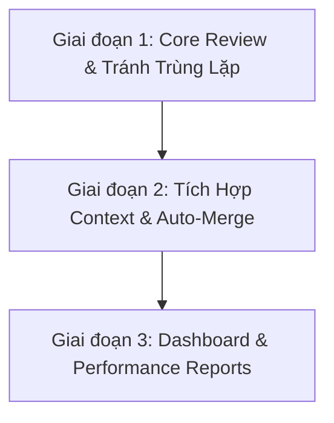

# Design Spec: Aider - Automated Code Review & Performance Analytics System

Tài liệu này đặc tả thiết kế và lộ trình triển khai nâng cấp hệ thống Aider từ một công cụ tóm tắt commit thành một hệ thống Tự động Review Code (Automated Review) và Đo lường Hiệu suất (Performance Analytics) toàn diện theo các chỉ dẫn của chuyên gia Full stack.

---

## Lộ Trình Triển Khai (Roadmap)

Hệ thống được chia thành 3 giai đoạn chính để đảm bảo kiểm thử và tích hợp an toàn:

---

## Giai đoạn 1: Nâng Cấp Core Bot Review & Tránh Trùng Lặp Comment

Mục tiêu: Đảm bảo bot review chính xác về cả logic và nghiệp vụ, tránh làm loãng PR và đưa ra quyết định review chính thức trên GitHub.

### 1. Tránh trùng lặp comment (Spam/Dúp)
* **Giải pháp**: 
  - Đánh dấu comment của bot bằng một thẻ HTML ẩn `<!-- AIDER-BOT-REVIEW-COMMENT -->`.
  - Khi có sự kiện `synchronize` (push thêm code vào PR), bot sẽ gọi GitHub API `GET /repos/{owner}/{repo}/issues/{issue_number}/comments` để tìm comment cũ có chứa thẻ trên.
  - Nếu tìm thấy, bot dùng `PATCH /repos/{owner}/{repo}/issues/comments/{comment_id}` để ghi đè nội dung phân tích mới.
  - Nếu không tìm thấy, bot dùng `POST` để tạo mới.

### 2. Context Nghiệp Vụ (Business Domain Context)
* **Giải pháp**:
  - Quét thư mục [docs/](file:///c:/Users/OS/PROJECT1/docs) trong repository để đọc các tài liệu thiết kế (ví dụ: [self_hosting_guide.md](file:///c:/Users/OS/PROJECT1/docs/self_hosting_guide.md)).
  - Gửi nội dung các tài liệu này kèm theo Git Diff vào prompt của Gemini API dưới dạng bối cảnh nghiệp vụ dự án.
  - Cập nhật System Instruction để yêu cầu Gemini so sánh các thay đổi trong diff với tài liệu nghiệp vụ để phát hiện sự không đồng nhất về kiến trúc hoặc logic nghiệp vụ.

### 3. Tích hợp GitHub Reviews API (Approve / Request Changes)
* **Giải pháp**:
  - Sử dụng API `POST /repos/{owner}/{repo}/pulls/{pull_number}/reviews`.
  - Gemini sẽ phân tích mức độ nghiêm trọng của các lỗi tìm thấy và trả về kết quả quyết định:
    - `APPROVE`: Không có lỗi hoặc chỉ có các đề xuất nhỏ về style.
    - `REQUEST_CHANGES`: Có lỗi logic nghiêm trọng, lỗ hổng bảo mật, hoặc vi phạm nghiêm trọng tài liệu nghiệp vụ.
    - `COMMENT`: Có một số cảnh báo cần lưu ý nhưng không cản trước việc merge.

---

## Giai đoạn 2: Tích Hợp Context Mở rộng & Tự động hóa quy trình

Mục tiêu: Đọc thêm context từ các nguồn bên ngoài và tự động hóa khâu merge PR.

### 1. Đọc Jira Link & PR Description
* **Giải pháp**:
  - Phân tích nội dung tiêu đề và mô tả (body) của PR để tìm các liên kết Jira dạng `https://*.atlassian.net/browse/TASK-*` hoặc mã task `TASK-*`.
  - Tích hợp Jira API (nếu được cấu hình thông tin xác thực) để lấy thông tin mô tả chi tiết của task Jira đó, làm giàu thêm context nghiệp vụ cho Gemini.

### 2. Tự động Merge (Auto-Merge)
* **Giải pháp**:
  - Nếu cấu hình dự án cho phép tự động merge và kết quả Review của Bot là `APPROVE`.
  - Kiểm tra xem PR có vượt qua toàn bộ các trạng thái kiểm thử CI/CD bắt buộc của GitHub (Status Checks) hay không.
  - Thực hiện gọi API `PUT /repos/{owner}/{repo}/pulls/{pull_number}/merge` để merge PR tự động vào nhánh chính.

---

## Giai đoạn 3: Web Dashboard & Báo Cáo Hiệu Suất (Performance Reports)

Mục tiêu: Xây dựng giao diện hiển thị dữ liệu lịch sử review, thống kê hiệu suất lập trình viên.

### 1. Lưu trữ dữ liệu lịch sử Review
* **Giải pháp**:
  - Thiết lập cơ sở dữ liệu nhỏ (ví dụ: SQLite hoặc MongoDB) trên Backend Server để lưu lại các thông tin của mỗi lần review: PR Number, Tác giả, Thời gian, Số lượng lỗi phát hiện, Trạng thái Review (Approve/Request Changes), Điểm đánh giá chất lượng code.

### 2. Dashboard Báo Cáo Tuần/Ngày (Weekly & Daily Reports)
* **Giải pháp**:
  - Thiết kế các API endpoint:
    - `/api/reports/daily`: Tổng hợp các PR đã review trong ngày, các lỗi phổ biến.
    - `/api/reports/weekly`: Phân tích xu hướng chất lượng code theo tuần, các module hay bị lỗi nhất.
  - Nâng cấp [App.tsx](file:///c:/Users/OS/PROJECT1/frontend/src/App.tsx) để vẽ biểu đồ trực quan (ví dụ sử dụng Chart.js hoặc Recharts).

### 3. Đánh giá hiệu suất của lập trình viên (Developer Performance Metrics)
* **Giải pháp**:
  - Đo lường dựa trên các chỉ số phi định kiến:
    - Tỷ lệ PR được approve ngay từ lần đầu tiên.
    - Số lượng comment góp ý trung bình trên mỗi PR.
    - Tần suất commit và kích thước của mỗi PR (để khuyến khích chia nhỏ PR).
    - Thời gian phản hồi và sửa lỗi sau khi nhận Request Changes từ bot.
  - Hiển thị bảng xếp hạng (Leaderboard) thân thiện hoặc biểu đồ cá nhân của từng lập trình viên trên Dashboard.
